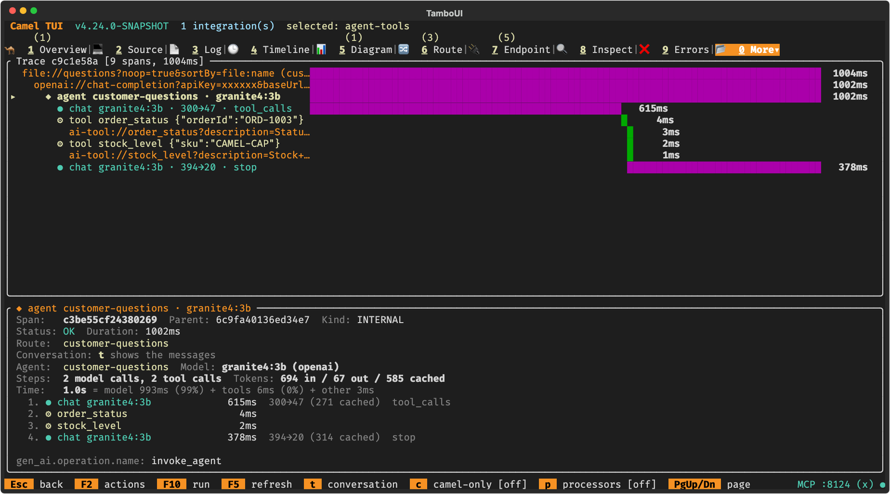
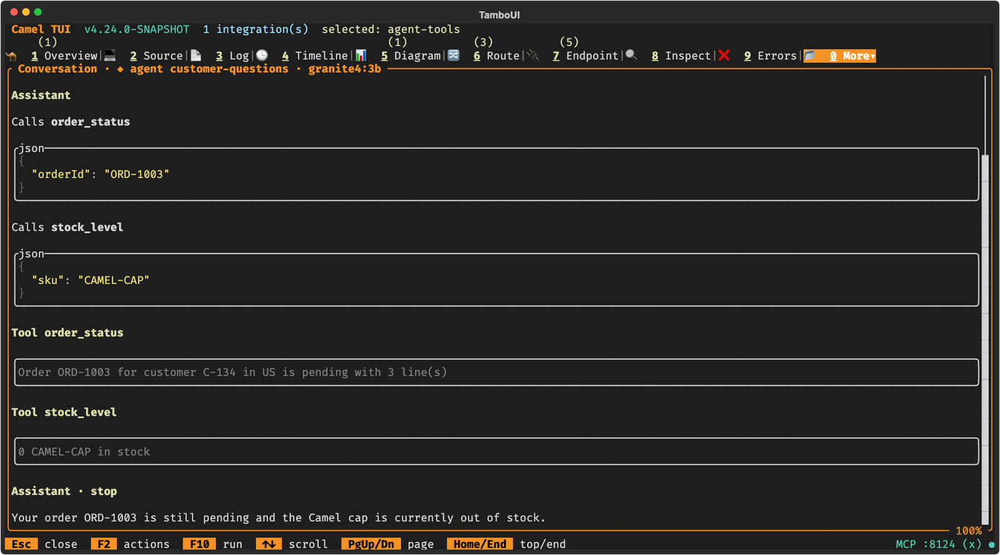

# AI agent with route tools

The shop's customers ask about their orders and the stock, and a local model answers. The model knows nothing of
the shop: the openai component offers it two routes as tools, runs the tool calls the model asks for and hands the
results back, until the model has its answer. Run with `--observe`, and the Camel TUI shows each agent run step by
step: the model calls, the tool calls, the tokens and the whole conversation.

## What you will see

```text
INFO ... agent-tools.camel.yaml:19  : Question question-1: Is order ORD-1001 paid?
INFO ... agent-tools.camel.yaml:115 : Tool order_status(ORD-1001): Order ORD-1001 for customer C-482 in DK is paid with 2 line(s)
INFO ... agent-tools.camel.yaml:32  : Answer question-1: Yes, order ORD-1001 is paid.
INFO ... agent-tools.camel.yaml:19  : Question question-2: How many Camel mugs do you have in stock?
INFO ... agent-tools.camel.yaml:75  : Tool stock_level(CAMEL-MUG): 42 CAMEL-MUG in stock
INFO ... agent-tools.camel.yaml:32  : Answer question-2: We have 42 Camel mugs in stock.
INFO ... agent-tools.camel.yaml:19  : Question question-3: Order ORD-1003 has a Camel cap in it: is the order paid, and is the cap in stock?
INFO ... agent-tools.camel.yaml:115 : Tool order_status(ORD-1003): Order ORD-1003 for customer C-134 in US is pending with 3 line(s)
INFO ... agent-tools.camel.yaml:75  : Tool stock_level(CAMEL-CAP): 0 CAMEL-CAP in stock
INFO ... agent-tools.camel.yaml:32  : Answer question-3: Your order ORD-1003 is still pending and the Camel cap is currently out of stock.
```

The answers are the model's own words, so yours read differently; the tool calls are the same.

And in the Camel TUI, the agent run of the third question: two model calls and the two tool calls between them,
with the tokens and the time of each step.



Press `t` on the agent run, and the conversation shows what the model asked the tools, what they answered, and the
answer it wrote from that.



## Install Camel CLI

Install [JBang](https://www.jbang.dev/download/) and the Camel CLI as described in the
[root README](../../README.md#install-the-camel-cli); `camel --version` confirms the install. This example needs
Camel 4.24 or newer.

## Run it

The example needs a running Ollama with a model, which the Camel CLI starts for you in a container (Docker or
Podman must be running); the container pulls the `granite4:3b` model on first start, which takes a while. In one
terminal:

```shell
camel infra run ollama
```

In another terminal:

```shell
camel run * --observe
```

`--observe` turns on the observability services: health, metrics, and tracing of the routes for the Camel TUI.
`camel.aiObservability.level=full` in `application.properties` adds the GenAI observability (camel-ai-observability)
and has it record each agent run with its model and tool calls, and the messages. Besides the spans, it keeps the
newest runs in the `genai` dev console, which needs no tracer: the AI usage view of the TUI and the Camel MCP server
read it, so they work with a plain `camel run *` too. The Spans tab needs `--observe`.

In a third terminal, open the TUI and select the integration:

```shell
camel tui
```

- Press `F8` for the AI panel, then `Ctrl+U` for the AI usage: the model calls with their tokens, and a line with
  the agent runs, their model and tool calls, and the GenAI level. It reads the `genai` dev console and refreshes
  while it is open.
- Open the Spans tab (under More, shortcut `o`) and press `Enter` on a trace. In the waterfall, `◆` is the agent run,
  `●` a model call with its tokens, and `⚙` a tool call with its arguments; select the agent run to see its steps,
  tokens and time in the detail panel, and press `t` to read the conversation.

Without the TUI, `camel get genai` shows the `genai` dev console in the terminal: the model calls per model, and
the newest agent runs with their model and tool calls (`--content` adds the question of each run). Pick a run by its
id to read it from question to answer, with each tool call's arguments and result:

```shell
camel get genai --content
camel get genai --id 7
```

Over HTTP, run with `camel run * --console`, and `curl http://localhost:8080/q/dev/genai?content=true` gives the same.
An AI coding agent reads it over the Camel MCP server: `camel_runtime_ai_trace` for the runs, and
`camel_runtime_ai_conversation` for the messages of one run.

An Ollama installed on the machine works too, if its model can call tools: set `openai.model` in
`application.properties` to a model you have pulled. Stop the example with `ctrl` + `c` and the container with
`camel infra stop ollama`.

## How it works

- `agent-tools.camel.yaml` holds three routes. Route `customer-questions` reads each file in `questions/`, logs the
  question and sends it to `openai:chat-completion`, which talks to Ollama through its OpenAI-compatible API, with a
  system message that tells the model to look things up rather than guess.
- `tags: shop` on that endpoint is what makes it an agent: openai offers the model every `ai-tool` route tagged
  `shop`, and when the model answers with tool calls, openai calls those routes and sends their results back to the
  model, until it answers in text (`autoToolExecution`, on by default).
- Routes `stock-level` and `order-status` are the two tools, the same as in the
  [MCP server](../mcp-server/) example: `ai-tool` names each tool, describes it and its parameter for the model, and
  the route answers from `stock.json` or from `orders/`.
- `application.properties` points openai at Ollama and sets the GenAI observability level: `basic` (the default)
  records the model calls, `detailed` adds the agent runs and tool calls, `full` adds the messages.

## Build it step by step

Ask your assistant, or type it yourself, one step at a time, and run after each:

1. A route that reads the files in `questions/` and sends each question to `openai:chat-completion` on Ollama
   (`baseUrl`, `apiKey`, `model` from `application.properties`), and logs the answer; ask about the stock and see
   what the model makes of a question it has no data for.
2. Add the `stock_level` tool route with `ai-tool` and `tags: shop`, and `tags: shop` on the openai endpoint; run
   again and see the tool call in the log before the answer.
3. Add a system message that tells the model to use the tools and never guess.
4. Add the `order_status` tool and the question about order ORD-1003, which needs both tools.
5. Run with `--observe` and `camel.aiObservability.level=full`, and follow an agent run in the TUI.

## Try changing

- Ask something the tools cannot answer, such as the delivery date of an order, and see whether the model says so.
- Set `camel.aiObservability.level=detailed`: the TUI still shows the agent runs and tool calls, but no messages.
- Give a tool `returnDirect: true`, and its result becomes the answer without a second model call.

## Integration testing

The example comes with a test in the [Citrus](https://citrusframework.org/) YAML DSL,
`test/agent-tools.citrus.it.yaml`, which the Camel CLI runs:

```shell
camel test run test/agent-tools.citrus.it.yaml
```

The test starts Ollama on a side port, waits for the model, runs the example and verifies that the model called
the tools and answered the last question. It needs Docker and a model download, so CI does not run it.

## Help and contributions

If you hit any problem using Camel or have some feedback, then please
[let us know](https://camel.apache.org/community/support/).

We also love contributors, so
[get involved](https://camel.apache.org/community/contributing/) :-)

The Camel riders!
